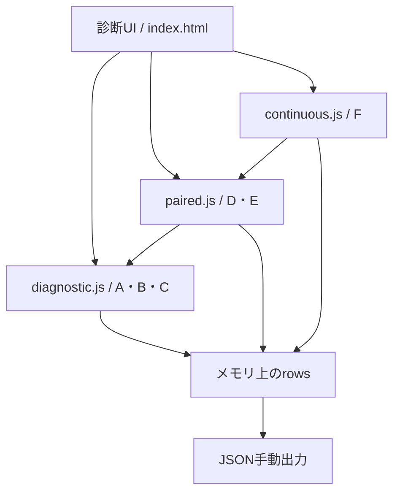

# StockLite 構成

## 調査時の構成境界

main=`d2ddf7a27edb36dc8289c35486480163fd74e9fb`。以下のルート構成が実在する。ローカル開発版をmainに含まれるものとして記載しない。

| パス | mainでの役割 |
|---|---|
| index.html | v10.2独立診断UI。html5-qrcode→ZXing→diagnostic.js→paired.js→continuous.jsの順で読込 |
| diagnostic.js | カメラ、A/B/C、計測、正否判定、集計、JSON出力、停止 |
| paired.js | D/E、同一画像の比較、PNG化、公開ファイルAPI、一致検査 |
| continuous.js | F、FrameConsensus、順次解析、10秒期限、停止後結果破棄 |
| verify.cjs | Node VMの模擬DOM/デコーダ試験。実機や実CDNデコーダの試験ではない |
| manifest.webmanifest・sw.js・service-worker.js・icon-*.png | 過去アプリから残る静的資産。現行診断indexはmanifestリンク/SW登録をしない |
| README_V9*.md・V*_TEST*.md等 | 過去版の資料。記載時点と対象版に限定して読む |
| 管理MD・docs/evidence | 今回の管理文書、測定集計/原本ハッシュ、ソース台帳。原本は非Git控え |

mainの診断ページはIndexedDB/在庫機能を呼ばない。既存登録済みSWが同じオリジンに残っている場合の配信影響は未検証。

ローカル`diagnostics/v10-photo-live`の`1f396c1662a5e1179d08f9ca37ddea4d97074600`には、ルートv9.4.1本体、diagnostics-v10(v10.3)、ios-candidate(v10.4.2)が存在する。これらのディレクトリは調査時mainには存在しない。現状は未移管のソースで、`git show 1f396c1662a5e1179d08f9ca37ddea4d97074600:ios-candidate/index.html`等でローカル確認可能。別環境から当該コミットを取得できる保証はない。

## 依存関係とデータの流れ

v9/統合候補の在庫データ経路は「認識→handleCode→pending→数量確定→persist→IndexedDB」。コード識別と在庫保存は分離される。ローカル統合候補はiOSだけ別フレーム2回一致後にhandleCodeへ渡す。写真は自然寸法canvas→PNG→ZXing画像API。AndroidはBarcodeDetectorが3形式対応なら採用し、その他はZXing連続API。

## 外部依存

| 依存 | 固定版/API | 利用 |
|---|---|---|
| html5-qrcode | 2.3.8、Html5Qrcode.start/pause/stop/clear/scanFile | mainのカメラとD比較、v9 iOS、統合候補の映像取得 |
| @zxing/library | 0.21.3 UMD、BrowserMultiFormatReader、decodeFromImageUrl | B/C/D/E/F、統合候補、Android fallback |
| ブラウザAPI | MediaDevices、MediaStreamTrack、video、canvas、Blob/ObjectURL、performance | カメラ、画像転送、設定、時間計測 |
| IndexedDB | v9/統合候補のみ | items/logs/settingsの端末内保存 |
| BarcodeDetector | 対応環境のみ | 本体Android分岐。iOS必須依存にしない |
| Node.js | 最低版未定。今回実行版はTEST_RESULTS参照 | 構文チェックと既存模擬試験 |

CDNはjsDelivr。package.json/ロックファイル/コンパイルビルドはない。固定URLであってもCDN取得と実APIの成功は別。初回オフラインのデコーダ起動は保証しない。

## 起動・配布・PWA

main診断: 全ルートファイルを同じ階層でHTTPS提供。PC構造確認は`python3 -m http.server 8000`→localhost。iPhoneからLANのHTTPへ接続する方法はカメラ試験に適さない。Node試験は`node verify.cjs`。

v9/統合版: index.html、manifest、sw、アイコンを同階層へ配置。統合版のiOSコードはindexにも埋込済み。アーカイブと実行入口をBUILDで照合する。ビルド手順が不要でも配置/キャッシュによる版違いは発生し得る。

旧sw.jsはstocklite-shell-20261016-camera-v9-3-testというキーを持ち、ネットワーク優先・同一オリジンのGETをキャッシュ。旧service-worker.jsは別キーで、v9本体の登録先はsw.js。統合候補は専用キャッシュプレフィックス。今回SW・manifestは変更しない。

配信先の別パスはデータ隔離にならない。既存PWA/DBの扱いを確認し、別オリジンで試す。全量バックアップをGitへ置かない。
